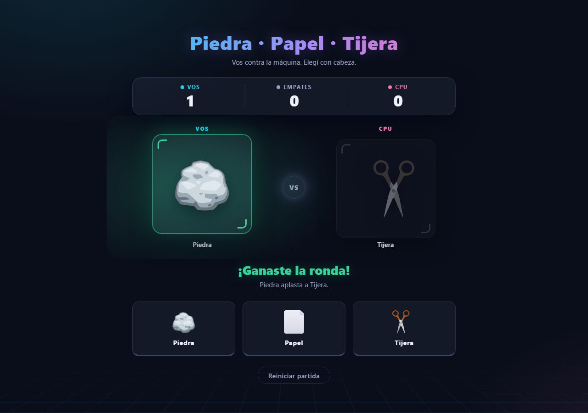

# Piedra · Papel · Tijera

Mini juego web contra la CPU, construido con **HTML, CSS y JavaScript vanilla** — sin frameworks, sin librerías, sin build. Diseño tipo arcade moderno: tema oscuro, glassmorphism y animaciones con puro CSS.



## Cómo jugar

No necesita servidor ni instalación: **abrí `index.html` en tu navegador** y listo.

Si preferís servirlo localmente:

```bash
npx serve .
# o
python -m http.server 8000
```

## Funcionalidades

- Jugador vs CPU con elección aleatoria.
- **Mejor de 5**: el primero en llegar a 3 victorias se lleva la partida. Los empates no cuentan: la ronda se repite.
- **Pips de partida** bajo cada marcador (○○○ → ●●○), estilo fighting game.
- **Pantalla de fin de partida** con overlay de victoria/derrota y botón "Jugar de nuevo"; las jugadas quedan bloqueadas.
- **Sonido sintetizado con Web Audio API** (cero archivos): ticks en la cuenta, ¡YA!, whoosh de revelado, y jingles distintos para ganar, perder y empatar. Botón mute con preferencia guardada en `localStorage`.
- **Estadísticas personales persistentes**: partidas jugadas y ganadas, efectividad, rondas ganadas, mejor racha y jugada más utilizada. Se guardan en el navegador y sobreviven al reinicio de una partida.
- **Tres temas visuales**: Neón clásico, Fuego arcade y Matriz digital. La elección queda guardada en el navegador.
- Marcador de rondas: victorias, empates y derrotas.
- Cuenta regresiva **3 · 2 · 1 · ¡YA!** gigante sobre la arena, con las manos bombeando.
- Identidad visual "arena de neón": piso de grilla synthwave y marcos de esquina estilo fighting game (cian para vos, magenta para la CPU).
- Cada resultado tiene su atmósfera: ganar inunda tu lado de verde y tu carta celebra; perder sacude la pantalla y hunde tu carta; empate pulsa ámbar.
- Resultado de cada ronda con frase descriptiva ("Piedra aplasta a Tijera").
- Tu jugada queda resaltada durante la cuenta regresiva; botones táctiles estilo arcade.
- Botón para reiniciar la partida (seguro incluso a mitad de ronda: cancela timers y sonidos).
- Responsive (desktop y mobile).

## Estructura

```
├── index.html      # Estructura semántica y accesibilidad
├── style.css       # Diseño (tokens CSS, animaciones, responsive)
├── app.js          # Orquestación de ronda, partida y DOM
├── game-logic.js   # Reglas puras, resultado de ronda y ganador de partida
├── statistics.js   # Estadísticas personales y persistencia local
├── preferences.js  # Preferencias de tema y persistencia local
├── sound.js        # SoundEngine: sonidos sintetizados con Web Audio API
├── tests/          # Pruebas unitarias con node:test
├── package.json    # Comando npm test, sin dependencias externas
├── .github/workflows/ci.yml # Tests y chequeo de sintaxis en cada push/PR
├── assets/         # Íconos SVG de piedra, papel y tijera
└── test-results/   # Capturas de verificación visual
```

## Decisiones de diseño

- **Reglas puras separadas de la interfaz**: `game-logic.js` contiene `getRoundResult()`, `randomChoice()` y `getMatchWinner()` sin tocar el DOM; se prueban directamente con `node:test`.
- **Responsabilidades aisladas**: `statistics.js` administra métricas de juego y `preferences.js` administra la paleta visual. Ambos toleran que el almacenamiento del navegador no esté disponible.
- **Dos máquinas de estado**: la de ronda (`idle → countdown → reveal → idle`) vive dentro de la de partida (jugar hasta que alguien llega a 3). El ganador de la partida es **estado derivado** de los scores, no un flag guardado: no hay nada que sincronizar a mano.
- **El sonido es un módulo aparte** (`sound.js`): el juego solo dice *qué* suena (`SoundEngine.play('win')`), nunca *cómo*. El `AudioContext` se crea con el primer gesto del usuario (política autoplay) y `stopAll()` garantiza que un reset no deje osciladores colgados. Export explícito a `window`: los `const` de tope nivel no cuelgan de `window` y el módulo quedaría inalcanzable desde tests externos.
- **Máquina de estados de ronda**: `idle → countdown → reveal → idle`. Un `roundToken` invalida la ronda en curso si se reinicia a mitad de camino (no hay estados fantasma).
- **Los SVG se usan con ``**: tienen colores fijos (no `currentColor`), así que inline no aportaría nada; con `` son cacheables y el HTML queda limpio.
- **Sin salto de layout**: la zona de resultado reserva su altura, el texto no empuja la interfaz.

## Accesibilidad

- Botones reales (`<button>`): teclado y lectores de pantalla funcionan sin código extra.
- Resultado anunciado con `role="status"` + `aria-live="polite"`.
- Foco visible (`:focus-visible`) en todos los controles.
- Respeta `prefers-reduced-motion`: reduce las animaciones si el usuario lo pidió a nivel sistema.

## Verificación

- `npm test` — **21/21 pruebas unitarias PASS** para reglas del juego, estadísticas y preferencias.
- CI en GitHub Actions ejecuta `npm test` y `node --check` sobre los módulos JavaScript en cada push y pull request.
- La captura `test-results/v3-tests.png` documenta la batería funcional previa; no reemplaza las pruebas unitarias versionadas.
- Capturas de flujo real en `test-results/` (ronda completa, overlay de fin de partida en desktop y mobile 390px).

## Próximas iteraciones (ideas)

- Historial de rondas.
- Logros y desafíos.
- Dificultades de CPU.
